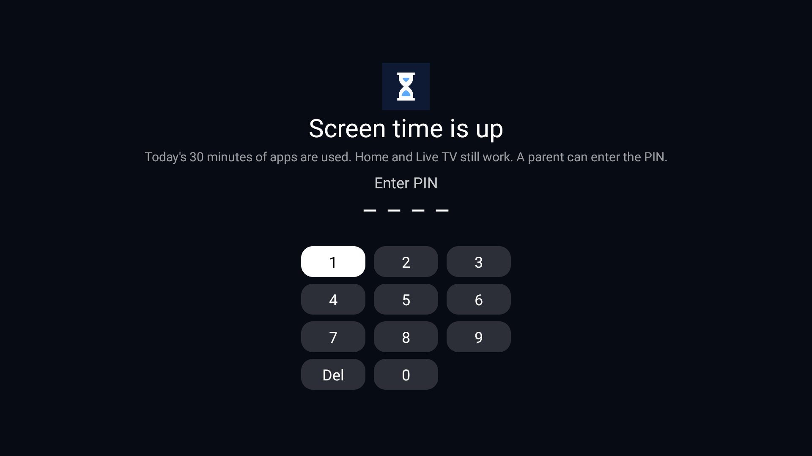
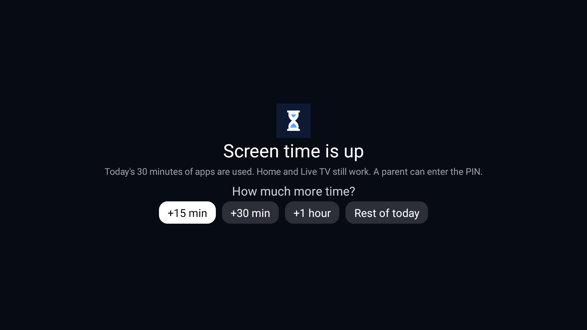
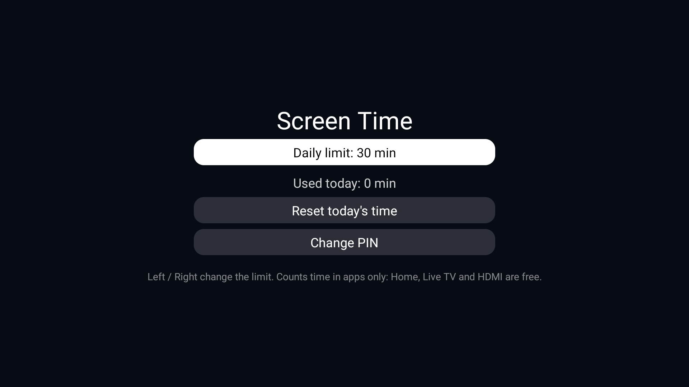

# Waktu Layar untuk Android TV

[English](README.md) · **Bahasa Indonesia**

Batas waktu layar harian yang kecil dan offline untuk Android TV dan Google TV. Anak-anak mendapat jatah menit
aplikasi per hari (bawaan 30 menit). Saat waktunya habis, setiap aplikasi terbuka di balik layar kunci penuh yang
hanya bisa dibuka dengan PIN 4 angka milik orang tua. Layar beranda, TV Live, dan input HDMI tetap bebas, jadi TV
tidak pernah terasa "rusak", hanya aplikasinya yang dijeda.

Tanpa akun, tanpa izin internet, tanpa iklan, tanpa pelacakan. Ukurannya sekitar 20 KB.

| Waktu habis | Setelah PIN | Pengaturan orang tua |
|---|---|---|
|  |  |  |

Tangkapan layar di atas berbahasa Inggris karena TV pengujinya berbahasa Inggris. Jika bahasa TV diatur ke Bahasa
Indonesia, aplikasi otomatis memakai teks Indonesia.

## Fitur

- **Batas harian untuk aplikasi**: bawaan 30 menit, bisa 5 sampai 480 menit, diubah per 15 menit di balik PIN.
- **Waktu bebas yang tidak pernah dihitung**: layar beranda, TV Live dan HDMI (aplikasi tuner/input bawaan TV),
  pemilih input, dan apa pun yang Anda daftarkan di [`config.xml`](app/src/main/res/values/config.xml).
- **Kunci layar penuh** di depan aplikasi yang dihitung setelah waktunya habis. Tombol Kembali tidak berfungsi;
  tombol Home kembali ke beranda yang bebas; membuka aplikasi lagi memunculkan kunci dalam satu detik. Aplikasi di
  belakangnya ikut berhenti.
- **Buka dengan PIN orang tua**, lalu pilih **+15 menit, +30 menit, +1 jam, atau sisa hari ini**. PIN bisa diketik
  dengan tombol angka remote atau dengan papan angka di layar memakai D-pad.
- **Peringatan** saat sisa 5 menit dan 1 menit.
- **Tetap tersimpan setelah TV dinyalakan ulang**: hitungan tidak hilang, jadi mematikan dan menyalakan TV tidak
  mengatur ulang batas. Hari baru dimulai tengah malam.
- **Cukup pakai remote**, dibuat untuk TV dengan RAM 1 GB: satu layanan latar ringan, tanpa animasi.
- **Antarmuka Bahasa Inggris dan Indonesia**, mengikuti bahasa TV.

## Kebutuhan

- Android TV atau Google TV dengan **Android 8.0 atau lebih baru** (API 26+). Diuji di TCL Google TV (Android 12).
- Komputer dengan **ADB** ([Android SDK Platform-Tools](https://developer.android.com/tools/releases/platform-tools))
  untuk memasang dan memberi izin. Di TV, izin akses penggunaan (usage access) hanya bisa diberikan lewat ADB karena
  TV tidak punya layar pengaturannya.
- Di TV: **Opsi pengembang > Debugging USB** (dan debugging jaringan jika TV menampilkannya terpisah) dinyalakan
  saat pemasangan. Setelah itu boleh dimatikan.
- Untuk membangun dari kode sumber: **JDK 17** dan **Android SDK** (platform 34, build-tools 34.0.0).

## Pemasangan

### 1. Dapatkan APK

Unduh `app-release.apk` dari halaman [Releases](../../releases), atau bangun sendiri:

```bash
./gradlew assembleRelease          # Windows: .\gradlew.bat assembleRelease
# -> app/build/outputs/apk/release/app-release.apk
```

Jika build tidak menemukan SDK Anda, buat dulu file `local.properties` berisi `sdk.dir=/lokasi/Android/Sdk`.

### 2. Pasang dan atur (satu perintah)

Cari alamat IP TV di **Setelan > Jaringan & Internet**, lalu:

```powershell
# Windows
powershell -ExecutionPolicy Bypass -File scripts\setup.ps1 -TvHost 192.168.1.50 -Pin 1234 -Limit 30
```

```bash
# macOS / Linux
scripts/setup.sh 192.168.1.50 1234 30
```

Pertama kali, TV akan bertanya **"Izinkan debugging USB?"**: centang *Selalu izinkan dari komputer ini* lalu pilih
**Izinkan**. Skrip memasang aplikasi, memberi tiga izinnya, mengatur PIN dan batas, lalu menjalankannya.

### Pengaturan manual (yang dilakukan skrip)

```bash
adb connect 192.168.1.50:5555
adb install -r app-release.apk
adb shell appops set local.tv.screentime GET_USAGE_STATS allow       # melihat aplikasi yang sedang di depan
adb shell appops set local.tv.screentime SYSTEM_ALERT_WINDOW allow   # membuka kunci dari latar belakang
adb shell appops set local.tv.screentime APP_AUTO_START allow        # TCL dan sejenisnya: jalan saat booting (lewati jika tidak dikenal)
adb shell appops write-settings
adb shell am broadcast -n local.tv.screentime/.AdminReceiver --es pin 1234 --ei limit 30
```

Baris terakhir boleh dilewati dan PIN dibuat langsung di TV: buka **Waktu Layar**, lalu masukkan PIN baru dua kali.

### 3. Opsional: sembunyikan ikonnya

Aplikasi ini punya ikon agar orang tua bisa membuka pengaturannya. Jika launcher Anda bisa menyembunyikan aplikasi
(atau menyimpannya di laci aplikasi), sembunyikan **Waktu Layar** agar anak tidak menemukannya. Pengaturannya tetap
terlindungi PIN.

## Cara memakai

**Anak-anak** cukup memakai TV seperti biasa. Lima menit dan satu menit sebelum habis, muncul pesan singkat. Saat
waktunya habis, membuka YouTube, Netflix, atau aplikasi lain yang dihitung akan memunculkan kunci. Beranda dan TV
Live tetap berfungsi.

**Orang tua** membuka kunci dengan PIN lalu memilih tambahan waktu: +15 menit, +30 menit, +1 jam, atau sisa hari
ini. Waktu tambahan berjalan sesuai jam (tidak menunggu aplikasi dibuka) dan tidak pernah melewati tengah malam.

**Pengaturan**: buka **Waktu Layar** dari daftar aplikasi lalu masukkan PIN:

| Pengaturan | Caranya |
|---|---|
| Batas harian | Kiri / Kanan di baris pertama, per 15 menit |
| Terpakai hari ini | Tampil di bawah batas |
| Waktu tambahan | Tampil selama waktu tambahan dari orang tua berjalan |
| Atur ulang waktu hari ini | Hitungan hari ini mulai lagi dari nol |
| Ganti PIN | Masukkan PIN baru dua kali |

### Dari komputer

Dengan debugging menyala, receiver yang sama dengan skrip pemasangan bisa mengubah pengaturan tanpa menyentuh TV:

```bash
adb shell am broadcast -n local.tv.screentime/.AdminReceiver --ei limit 45      # batas harian baru
adb shell am broadcast -n local.tv.screentime/.AdminReceiver --es pin 4321      # PIN baru
adb shell am broadcast -n local.tv.screentime/.AdminReceiver --ez reset true    # atur ulang hari ini
adb shell am broadcast -n local.tv.screentime/.AdminReceiver --ei used 30       # anggap 30 menit terpakai (uji coba)
adb logcat -s ScreenTime                                                        # status PIN / batas / terpakai
```

Hanya sistem dan shell ADB yang boleh mengirim perintah ini (receiver mewajibkan `android.permission.DUMP`), jadi
tidak ada aplikasi terpasang yang bisa mengubah PIN atau batasnya.

## Aplikasi yang bebas

Aplikasi bebas tidak pernah dihitung dan tidak pernah memunculkan kunci. Daftar bawaan di
[`app/src/main/res/values/config.xml`](app/src/main/res/values/config.xml):

| Paket | Keterangan |
|---|---|
| `com.gathin.tvhome` | Launcher [Clean Your TV](https://github.com/Gathin23/cleanyourtv) (layar beranda) |
| `com.tcl.tv` | Aplikasi TV Live TCL, sekaligus pemutar input HDMI |
| `com.tcl.tvinput`, `com.tcl.suspension` | Layanan input dan pemilih input TCL |
| `com.majnioui.tv.prayer` | Add-on Jadwal Salat (Prayer Times) |
| `local.tv.screentime` | Aplikasi ini (pengaturannya) |
| `com.android.systemui`, `android` | Layar sistem |

**Di TV merek lain, tambahkan layar beranda dan aplikasi TV Live Anda sendiri** di sini lalu bangun ulang. Untuk
mengetahui nama paketnya, buka aplikasinya lalu jalankan:

```bash
adb shell dumpsys activity activities | grep -m1 mResumedActivity
```

Yang umum: beranda Google TV `com.google.android.apps.tv.launcherx`, beranda Android TV
`com.google.android.tvlauncher`, TV Live Sony `com.sony.dtv.tvx`, Philips `org.droidtv.playtv`, Xiaomi PatchWall
`com.mitv.tvhome`. Setelan (`com.android.tv.settings`) sengaja **tidak** dibebaskan: jika bebas, anak bisa membuka
Setelan dan menghentikan paksa Waktu Layar setelah waktunya habis.

## Keterbatasan

Pahami apa yang bisa dan tidak bisa dilakukan aplikasi tanpa hak pemilik perangkat (device owner):

- **Hentikan paksa sebelum batas.** Orang yang tahu caranya bisa membuka Setelan > Aplikasi > Waktu Layar >
  Hentikan paksa selama waktu masih tersisa. Hitungan lalu berhenti sampai TV dinyalakan ulang. (Setelah waktu
  habis, Setelan ikut terkunci seperti aplikasi lain.) Menyembunyikan ikon aplikasi membantu.
- **Sampai satu detik isi aplikasi** bisa terlihat sebelum kunci muncul: setelah batas tercapai, layanan memeriksa
  aplikasi di depan setiap detik.
- **TV Live dan HDMI sengaja dibebaskan.** Konsol game di HDMI tidak dibatasi. Hapus aplikasi TV Live dari
  `free_apps` jika ingin ikut dihitung.
- **Waktu dihitung per 5 detik** selama masih tersisa, jadi totalnya bisa selisih beberapa detik.
- **Mengubah jam TV** menggeser batas hari dan akhir waktu tambahan, karena keduanya memakai jam dinding.
- **ADB adalah kunci induk.** Siapa pun di jaringan Anda yang punya akses ADB bisa mengubah semuanya, karena itu
  matikan debugging USB/jaringan setelah pemasangan.

## Pemecahan masalah

| Masalah | Solusi |
|---|---|
| Kunci tidak pernah muncul | Periksa akses penggunaan: `adb shell appops get local.tv.screentime GET_USAGE_STATS` harus `allow`. PIN harus sudah diatur (`adb logcat -s ScreenTime` menampilkan `pin set=true`). |
| Kunci muncul di beranda atau TV Live | Paket beranda atau TV Live Anda belum ada di `free_apps`. Cari namanya (lihat di atas), tambahkan, lalu bangun ulang. |
| Hitungan berhenti setelah TV dinyalakan ulang | Di TCL (dan beberapa merek lain) berikan `APP_AUTO_START`, lalu `appops write-settings` *sebelum* menyalakan ulang. Periksa dengan `adb shell dumpsys activity services local.tv.screentime`. |
| "failed to read copy response" saat `adb install` | Gangguan jaringan saat transfer besar; APK ini kecil, jadi cukup ulangi. |
| `INSTALL_FAILED_UPDATE_INCOMPATIBLE` | Salinan terpasang ditandatangani kunci lain (misalnya build GitHub Actions di atas build lokal). Copot dulu: `adb uninstall local.tv.screentime`, lalu atur ulang. |
| Lupa PIN | Dengan ADB: `adb shell am broadcast -n local.tv.screentime/.AdminReceiver --es pin 0000`. |
| Menghapus sepenuhnya | `adb uninstall local.tv.screentime`. |

## Privasi dan izin

Waktu Layar **tidak punya izin internet**. Tidak ada data yang keluar dari TV. PIN hanya disimpan sebagai hash
SHA-256 di penyimpanan pribadi aplikasi, dan cadangan aplikasi dimatikan. (Empat angka mudah dicoba satu per satu
oleh siapa pun yang bisa membaca penyimpanan itu, yang butuh akses root, jadi anggap PIN sebagai kunci untuk anak,
bukan rahasia.)

| Izin | Alasan |
|---|---|
| `PACKAGE_USAGE_STATS` | Melihat aplikasi yang di depan, agar hanya aplikasi yang dihitung dan dikunci. Diberikan lewat ADB. |
| `SYSTEM_ALERT_WINDOW` | Android mengizinkan aplikasi yang memilikinya membuka layar (kunci) dari latar belakang. |
| `FOREGROUND_SERVICE`, `FOREGROUND_SERVICE_SPECIAL_USE` | Menjaga layanan penghitung tetap hidup; menampilkan notifikasi senyap yang diperkecil. |
| `RECEIVE_BOOT_COMPLETED` | Mulai menghitung lagi setelah TV dinyalakan ulang. |
| `POST_NOTIFICATIONS` | Hanya Android 13+: memperbarui notifikasi itu. Tanpa izin ini notifikasinya hanya berhenti diperbarui. |

## Cara kerja

Layanan latar depan (foreground service) membaca kejadian penggunaan Android untuk mengetahui aplikasi di depan
(setiap 5 detik selama menghitung, setiap detik setelah waktu habis, setiap 30 detik saat layar mati). Detik di
aplikasi yang dihitung ditambahkan ke total hari ini. Saat batas tercapai, layanan membuka `LockActivity` di task
tersendiri di depan aplikasi. Penjelasan lengkap, termasuk alasan kunci berupa activity dan bukan jendela overlay,
ada di [docs/HOW-IT-WORKS.md](docs/HOW-IT-WORKS.md) (Bahasa Inggris).

## Struktur proyek

```
app/src/main/java/local/tv/screentime/
  TimeService.java      penghitungan, peringatan, membuka kunci
  LockActivity.java     layar kunci penuh dan pilihan waktu tambahan
  SettingsActivity.java pengaturan orang tua di balik PIN; membuat PIN pertama kali
  PinPad.java           input PIN 4 angka untuk remote
  Store.java            pengaturan dan hitungan hari ini (SharedPreferences, PIN di-hash)
  AdminReceiver.java    pengaturan khusus ADB: PIN, batas, atur ulang
  BootReceiver.java     menjalankan layanan setelah TV dinyalakan ulang
  Ui.java               pembantu tampilan kecil
app/src/main/res/values/config.xml      batas bawaan dan aplikasi bebas
app/src/main/res/values-in/strings.xml  teks Bahasa Indonesia
scripts/setup.ps1, scripts/setup.sh     pemasangan dan pengaturan lewat ADB
```

## Build dan rilis

- `./gradlew assembleRelease` membangun APK yang diperkecil. APK **ditandatangani dengan kunci debug** agar bisa
  dipasang lewat ADB tanpa langkah tambahan. Jika Anda membagikan APK ke orang lain, tandatangani dengan kunci Anda
  sendiri.
- GitHub Actions ([`.github/workflows/build.yml`](.github/workflows/build.yml)) membangun APK setiap push dan pull
  request dan menyimpannya sebagai artifact yang bisa diunduh. Push tag seperti `v1.0.0` juga menerbitkannya di
  halaman Releases. Setiap runner punya kunci debug sendiri, jadi build CI tidak bisa memperbarui instalasi hasil
  build lokal (copot dulu).

## Kontribusi

Issue dan pull request dipersilakan, terutama nama paket layar beranda dan aplikasi TV Live di TV merek lain untuk
`free_apps`. Mohon uji perubahan di TV sungguhan dan sebutkan model serta versi Android yang dipakai.

## Kredit dan lisensi

Dibuat untuk TV keluarga yang diatur dengan [Clean Your TV](https://github.com/Gathin23/cleanyourtv), tetapi bisa
dipakai dengan launcher apa pun. Dirilis di bawah [Lisensi MIT](LICENSE).
