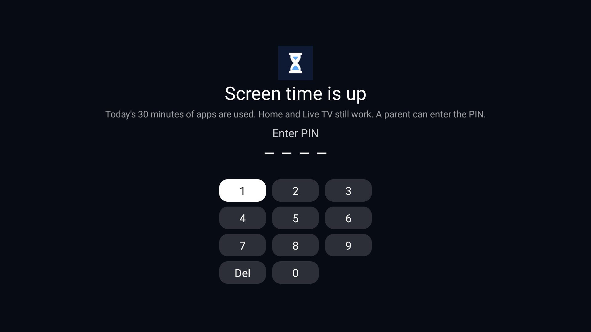
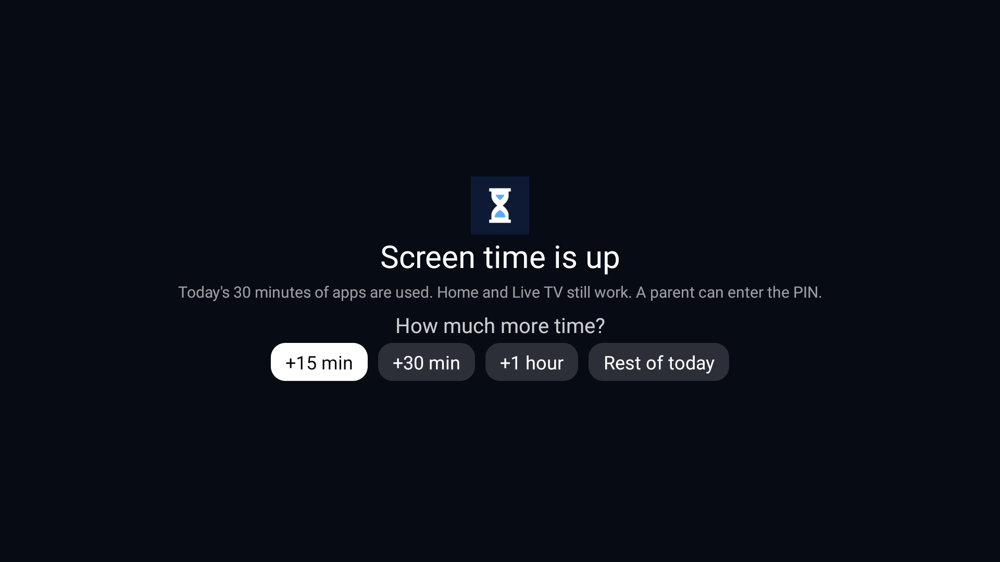
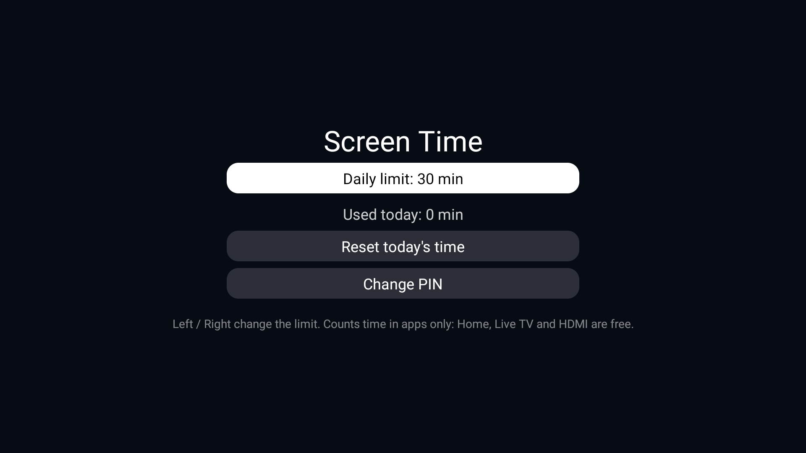

# Screen Time for Android TV

**English** · [Bahasa Indonesia](README.id.md)

A small, offline daily screen-time limit for Android TV and Google TV. Children get a set number of minutes of
apps per day (30 by default). When the time is up, any app opens behind a full-screen lock that only a parent's
4-digit PIN removes. The home screen, Live TV and HDMI inputs stay free, so the TV is never "broken", only the apps
are paused.

No account, no internet permission, no ads, no tracking. About 20 KB.

| Time is up | After the PIN | Parent settings |
|---|---|---|
|  |  |  |

## Features

- **Daily limit for apps**: 30 minutes by default, 5 to 480 minutes, changed in 15-minute steps behind the PIN.
- **Free time that never counts**: the home screen, Live TV and HDMI (the TV's own tuner/input app), the input
  switcher and anything else you list in [`config.xml`](app/src/main/res/values/config.xml).
- **Full-screen lock** in front of any counted app once the time is used. Back does nothing; Home returns to the
  free home screen; opening an app again brings the lock back within a second. The app underneath pauses.
- **Parent PIN unlock** with a choice of **+15 min, +30 min, +1 hour or the rest of today**. The PIN can be typed
  with the remote's number keys or on the on-screen keypad with the D-pad.
- **Warnings** at 5 minutes and 1 minute left.
- **Survives reboots**: the count is kept, so switching the TV off and on does not reset it. A new day starts at
  midnight.
- **Works with the remote alone**, made for 1 GB TVs: one light background service, no animations.
- **English and Indonesian** interface, following the TV's language.

## Requirements

- An Android TV or Google TV running **Android 8.0 or newer** (API 26+). Tested on a TCL Google TV (Android 12).
- A computer with **ADB** ([Android SDK Platform-Tools](https://developer.android.com/tools/releases/platform-tools))
  to install it and grant its permissions. Android only lets ADB grant usage access to an app on a TV, since TVs
  have no settings screen for it.
- On the TV: **Developer options > USB debugging** (and network debugging, if your TV lists it separately) switched
  on during setup. You can switch it off afterwards.
- To build from source: **JDK 17** and the **Android SDK** (platform 34, build-tools 34.0.0).

## Install

### 1. Get the APK

Either download `app-release.apk` from the [Releases](../../releases) page, or build it:

```bash
./gradlew assembleRelease          # Windows: .\gradlew.bat assembleRelease
# -> app/build/outputs/apk/release/app-release.apk
```

Create a `local.properties` file with `sdk.dir=/path/to/Android/Sdk` first if the build cannot find your SDK.

### 2. Install and set up (one command)

Find the TV's IP address under **Settings > Network & Internet**, then:

```powershell
# Windows
powershell -ExecutionPolicy Bypass -File scripts\setup.ps1 -TvHost 192.168.1.50 -Pin 1234 -Limit 30
```

```bash
# macOS / Linux
scripts/setup.sh 192.168.1.50 1234 30
```

The first time, the TV asks **"Allow USB debugging?"**: tick *Always allow from this computer* and choose
**Allow**. The script installs the app, grants its three permissions, sets the PIN and the limit, and starts it.

### Manual setup (what the script does)

```bash
adb connect 192.168.1.50:5555
adb install -r app-release.apk
adb shell appops set local.tv.screentime GET_USAGE_STATS allow       # see which app is in front
adb shell appops set local.tv.screentime SYSTEM_ALERT_WINDOW allow   # open the lock from the background
adb shell appops set local.tv.screentime APP_AUTO_START allow        # TCL and similar: start at boot (skip if unknown)
adb shell appops write-settings
adb shell am broadcast -n local.tv.screentime/.AdminReceiver --es pin 1234 --ei limit 30
```

You can also skip the last line and create the PIN on the TV: open **Screen Time** and it asks for a new PIN twice.

### 3. Optional: hide its icon

The app has a tile so parents can reach its settings. If your launcher can hide apps (or keeps them in an app
drawer), hide **Screen Time** there so children do not stumble on it. The settings are behind the PIN either way.

## Using it

**Children** simply use the TV. Five minutes and one minute before the end, a short message appears. When the
time is up, opening YouTube, Netflix or any other counted app shows the lock. Home and Live TV keep working.

**Parents** unlock it with the PIN and pick how much more time to give: +15 min, +30 min, +1 hour or the rest of
today. The extra time runs on the clock (it does not wait for the app) and never goes past midnight.

**Settings**: open **Screen Time** from the app list and enter the PIN:

| Setting | How |
|---|---|
| Daily limit | Left / Right on the first row, 15-minute steps |
| Used today | Shown under the limit |
| Extra time | Shown while a parent's extra time is running |
| Reset today's time | Starts today's count again from zero |
| Change PIN | Enter the new PIN twice |

### From the computer

With debugging on, the same receiver the setup uses changes things without touching the TV:

```bash
adb shell am broadcast -n local.tv.screentime/.AdminReceiver --ei limit 45      # new daily limit
adb shell am broadcast -n local.tv.screentime/.AdminReceiver --es pin 4321      # new PIN
adb shell am broadcast -n local.tv.screentime/.AdminReceiver --ez reset true    # reset today
adb shell am broadcast -n local.tv.screentime/.AdminReceiver --ei used 30       # pretend 30 min are used (testing)
adb logcat -s ScreenTime                                                        # current PIN set / limit / used
```

Only the system and the ADB shell may send these (the receiver requires `android.permission.DUMP`), so no
installed app can change the PIN or the limit.

## Which apps are free

Free apps never count and never show the lock. The defaults in
[`app/src/main/res/values/config.xml`](app/src/main/res/values/config.xml):

| Package | What it is |
|---|---|
| `com.gathin.tvhome` | [Clean Your TV](https://github.com/Gathin23/cleanyourtv) launcher (home screen) |
| `com.tcl.tv` | TCL's Live TV app, which also plays the HDMI inputs |
| `com.tcl.tvinput`, `com.tcl.suspension` | TCL input services and input switcher |
| `com.majnioui.tv.prayer` | Prayer Times add-on |
| `local.tv.screentime` | This app (its settings) |
| `com.android.systemui`, `android` | System screens |

**On another TV brand, add your own home screen and Live TV app here** and rebuild. To find their package names,
open the app and run:

```bash
adb shell dumpsys activity activities | grep -m1 mResumedActivity
```

Common ones: Google TV home `com.google.android.apps.tv.launcherx`, Android TV home
`com.google.android.tvlauncher`, Sony Live TV `com.sony.dtv.tvx`, Philips `org.droidtv.playtv`,
Xiaomi PatchWall `com.mitv.tvhome`. Settings (`com.android.tv.settings`) is deliberately **not** free: otherwise a
child could open Settings and force-stop Screen Time once the time is up.

## Limitations

Be honest with yourself about what an app without device-owner rights can and cannot do:

- **Force stop before the limit.** Someone who knows where to look can open Settings > Apps > Screen Time >
  Force stop while time remains. Counting then stops until the next reboot. (Once the time is up, Settings is
  locked like any other app.) Hiding the app's tile helps.
- **Up to a second of an app** can show before the lock comes up: the service checks the front app once a second
  after the limit.
- **Live TV and HDMI are free by design.** A game console on HDMI is not limited. Remove the TV's Live TV app
  from `free_apps` if you want it counted.
- **Time is counted in 5-second steps** while time remains, so the total can be a few seconds off.
- **Changing the TV's clock** moves the day boundary and the extra-time end, since both use the wall clock.
- **ADB is the master key.** Anyone on your network with ADB access can change everything, which is why you
  should switch USB/network debugging off after setup.

## Troubleshooting

| Problem | Fix |
|---|---|
| The lock never appears | Check usage access: `adb shell appops get local.tv.screentime GET_USAGE_STATS` must say `allow`. A PIN must be set (`adb logcat -s ScreenTime` shows `pin set=true`). |
| The lock appears on the home screen or Live TV | Your TV's home or Live TV package is not in `free_apps`. Find it (see above), add it, rebuild. |
| Counting stops after a reboot | On TCL (and some other brands) grant `APP_AUTO_START`, then `appops write-settings` *before* rebooting. Check with `adb shell dumpsys activity services local.tv.screentime`. |
| "failed to read copy response" during `adb install` | A network hiccup on a large transfer; this APK is small, so simply retry. |
| `INSTALL_FAILED_UPDATE_INCOMPATIBLE` | The installed copy was signed with another key (for example a GitHub Actions build over a local build). Uninstall first: `adb uninstall local.tv.screentime`, then set it up again. |
| Forgot the PIN | With ADB: `adb shell am broadcast -n local.tv.screentime/.AdminReceiver --es pin 0000`. |
| Remove it completely | `adb uninstall local.tv.screentime`. |

## Privacy and permissions

Screen Time has **no internet permission**. Nothing leaves the TV. The PIN is stored only as a SHA-256 hash in the
app's private storage, and app backups are off. (Four digits are easy to try out by anyone who can read that
storage, which needs root, so treat the PIN as a lock for children, not a secret.)

| Permission | Why |
|---|---|
| `PACKAGE_USAGE_STATS` | See which app is in front, to count only apps and lock only apps. Granted with ADB. |
| `SYSTEM_ALERT_WINDOW` | Android lets apps holding it open a screen (the lock) from the background. |
| `FOREGROUND_SERVICE`, `FOREGROUND_SERVICE_SPECIAL_USE` | Keep the counting service alive; it shows a silent, minimised notice. |
| `RECEIVE_BOOT_COMPLETED` | Start counting again after the TV restarts. |
| `POST_NOTIFICATIONS` | Android 13+ only: update that notice. Without it the notice just stops updating. |

## How it works

A foreground service polls Android's usage events for the app in front (every 5 seconds while counting, every
second once the time is up, every 30 seconds with the screen off). Seconds in counted apps are added to today's
total. At the limit it opens `LockActivity` in its own task in front of the app. More detail, and why the lock is
an activity and not an overlay window, in [docs/HOW-IT-WORKS.md](docs/HOW-IT-WORKS.md).

## Project layout

```
app/src/main/java/local/tv/screentime/
  TimeService.java      counting, warnings, opening the lock
  LockActivity.java     the full-screen lock and the extra-time choices
  SettingsActivity.java parent settings behind the PIN; creates the PIN the first time
  PinPad.java           4-digit PIN entry for the remote
  Store.java            settings and today's count (SharedPreferences, hashed PIN)
  AdminReceiver.java    ADB-only setup: PIN, limit, reset
  BootReceiver.java     starts the service after a reboot
  Ui.java               small view helpers
app/src/main/res/values/config.xml   default limit and free apps
scripts/setup.ps1, scripts/setup.sh  install and set up over ADB
```

## Building and releasing

- `./gradlew assembleRelease` builds a minified APK. It is **signed with the debug key** so that it installs over
  ADB without extra steps. If you hand APKs to other people, sign them with your own key instead.
- GitHub Actions ([`.github/workflows/build.yml`](.github/workflows/build.yml)) builds the APK on every push and
  pull request and keeps it as a downloadable artifact. Pushing a tag such as `v1.0.0` also publishes it on the
  Releases page. Each runner has its own debug key, so a CI build cannot update a locally built install (uninstall
  first).

## Contributing

Issues and pull requests are welcome, especially package names of home screens and Live TV apps on other TV
brands for `free_apps`. Please test changes on a real TV and say which model and Android version you used.

## Credits and licence

Made for a family TV set up with [Clean Your TV](https://github.com/Gathin23/cleanyourtv), but it works with any
launcher. Released under the [MIT Licence](LICENSE).
